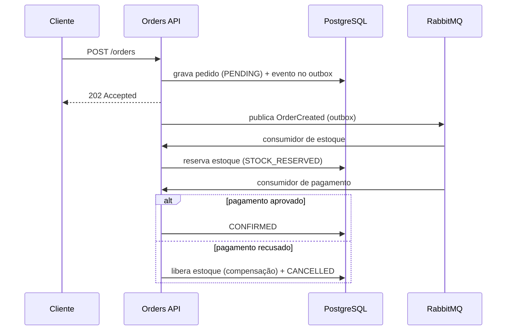
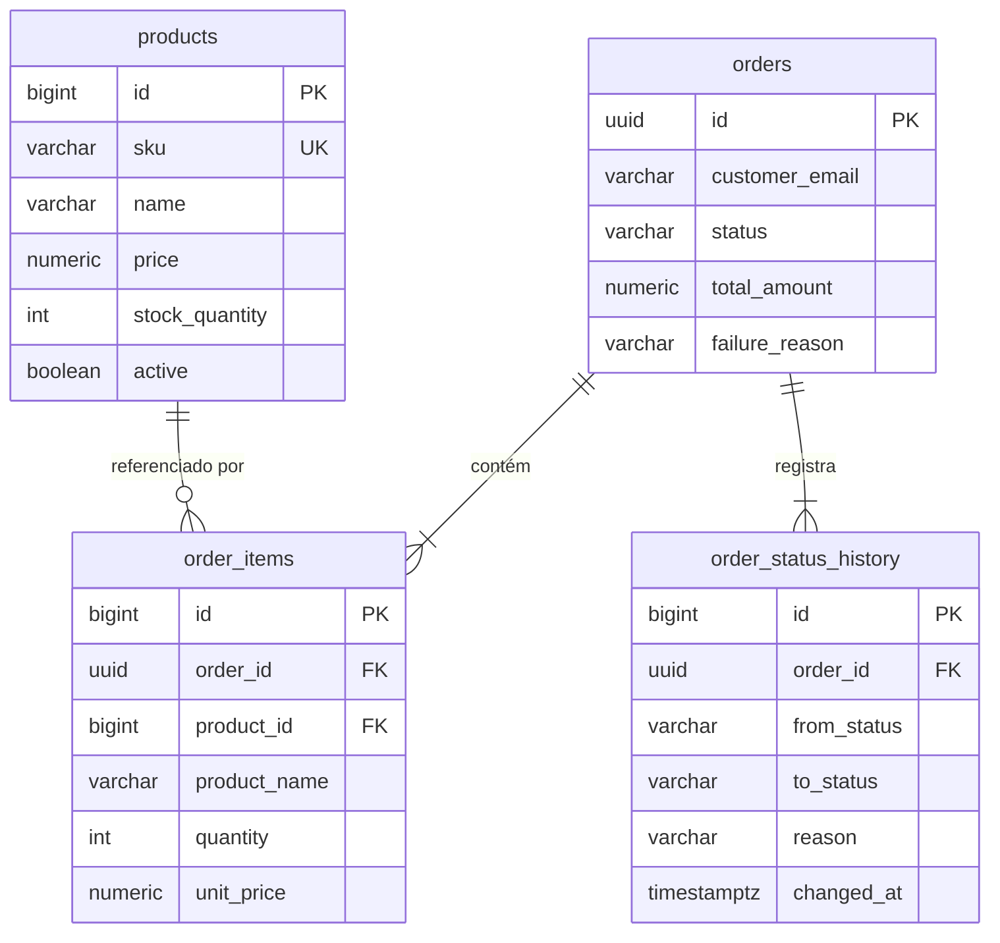

# Orders API

API de pedidos construída com **Java 25** e **Spring Boot 4.1**, evoluindo de um fluxo síncrono
para um processamento **assíncrono orientado a eventos** com RabbitMQ — com retry, DLQ,
consumidores idempotentes, outbox pattern, saga com compensação e lock otimista.

O projeto é desenvolvido em fases, cada uma adicionando um conceito de back-end de forma incremental.

## Status

| Fase | Escopo | Status |
|------|--------|--------|
| 1 | Docker Compose, migrations, CRUD de produtos, pedidos síncronos | ✅ Concluída |
| 2 | RabbitMQ: `POST /orders` → 202, consumidores de estoque e pagamento | ⏳ Próxima |
| 3 | Retry com backoff, DLQ, consumidores idempotentes | 🔜 |
| 4 | Outbox pattern, saga com compensação, lock otimista no estoque | 🔜 |
| 5 | Testes de integração, observabilidade, Docker da aplicação, CI com GitHub Actions, Swagger/OpenAPI | 🔜 |

## Stack

- **Java 25** · **Spring Boot 4.1** (Web MVC, Data JPA, Validation, AMQP, Actuator)
- **PostgreSQL 17** com migrations versionadas via **Flyway**
- **RabbitMQ 4** (com painel de gerenciamento)
- **Docker Compose** para o ambiente local
- **Testcontainers** para testes com banco e broker reais
- **Maven** (wrapper incluso) · **Lombok**

## Fluxo alvo



Na **Fase 1** (atual), criação do pedido e reserva de estoque acontecem de forma síncrona,
na mesma transação, e o endpoint responde `201 Created`.

## Como rodar

**Pré-requisitos:** JDK 25 e Docker.

```bash
# 1. Sobe PostgreSQL e RabbitMQ
docker compose up -d

# 2. Roda a aplicação (as migrations são aplicadas automaticamente)
./mvnw spring-boot:run        # Windows: mvnw.cmd spring-boot:run
```

| Serviço | Endereço | Credenciais |
|---------|----------|-------------|
| API | http://localhost:8080 | — |
| Health check | http://localhost:8080/actuator/health | — |
| PostgreSQL | `localhost:5433` / banco `orders` | `orders` / `orders` |
| RabbitMQ (painel) | http://localhost:15672 | `guest` / `guest` |

> O PostgreSQL é exposto na porta **5433** para não conflitar com uma instalação local na 5432.

### Testes

```bash
./mvnw test
```

Os testes sobem PostgreSQL e RabbitMQ reais via Testcontainers (requer Docker em execução).

## Endpoints

### Produtos

| Método | Rota | Descrição | Sucesso |
|--------|------|-----------|---------|
| `POST` | `/products` | Cria produto | `201` + `Location` |
| `GET` | `/products?page=0&size=20&sort=name` | Lista produtos ativos (paginado) | `200` |
| `GET` | `/products/{id}` | Busca produto | `200` |
| `PUT` | `/products/{id}` | Atualiza produto | `200` |
| `DELETE` | `/products/{id}` | Desativa produto (soft delete) | `204` |

```bash
curl -X POST http://localhost:8080/products \
  -H "Content-Type: application/json" \
  -d '{"sku":"CAM-AZ-M","name":"Camiseta Azul M","price":59.90,"stockQuantity":10}'
```

### Pedidos

| Método | Rota | Descrição | Sucesso |
|--------|------|-----------|---------|
| `POST` | `/orders` | Cria pedido e reserva estoque | `201` + `Location` |
| `GET` | `/orders/{id}` | Detalhe com itens e histórico de status | `200` |
| `GET` | `/orders?page=0&size=20` | Lista resumida, mais recentes primeiro | `200` |

```bash
curl -X POST http://localhost:8080/orders \
  -H "Content-Type: application/json" \
  -d '{"customerEmail":"cliente@email.com","items":[{"productId":1,"quantity":2}]}'
```

<details>
<summary>Exemplo de resposta</summary>

```json
{
  "id": "3749f699-d2f0-4536-a5aa-0fd33f67e5ea",
  "customerEmail": "cliente@email.com",
  "status": "STOCK_RESERVED",
  "totalAmount": 99.80,
  "failureReason": null,
  "items": [
    { "productId": 1, "productName": "Camiseta Azul M", "quantity": 2, "unitPrice": 49.90, "subtotal": 99.80 }
  ],
  "statusHistory": [
    { "from": null, "to": "PENDING", "reason": null, "changedAt": "2026-10-15T21:49:03.808Z" },
    { "from": "PENDING", "to": "STOCK_RESERVED", "reason": null, "changedAt": "2026-10-15T21:49:03.812Z" }
  ],
  "createdAt": "2026-10-15T21:49:03.813Z",
  "updatedAt": "2026-10-15T21:49:03.813Z"
}
```

</details>

### Erros

Todos os erros seguem o formato **Problem Details** ([RFC 9457](https://www.rfc-editor.org/rfc/rfc9457)):

```json
{
  "status": 422,
  "title": "Regra de negócio violada",
  "detail": "Estoque insuficiente para o produto CANECA-01 (disponível: 2, solicitado: 99)",
  "instance": "/orders"
}
```

| Status | Quando |
|--------|--------|
| `400` | Campos inválidos (com mapa `errors` por campo), parâmetros malformados |
| `404` | Recurso não encontrado |
| `409` | Conflito, ex.: SKU duplicado |
| `422` | Regra de negócio, ex.: estoque insuficiente, produto inativo |

## Decisões de design

- **Organização por feature** (`product`, `order`, `shared`...) em vez de por camada: tudo de uma
  funcionalidade fica junto, facilitando navegação e evolução.
- **Schema controlado só pelo Flyway**, com `ddl-auto=validate`: o Hibernate apenas confere se as
  entidades batem com o banco e a aplicação não sobe se houver divergência.
- **Constraints no banco** (`CHECK`, `UNIQUE`, `FK`) como última linha de defesa, além da validação na API.
- **UUID como ID do pedido**: não é sequencial (não expõe volume nem permite enumerar pedidos) e é
  gerado pela aplicação, o que facilita a correlação em eventos nas próximas fases.
- **Preço e nome copiados para o item do pedido**: o pedido preserva os valores do momento da compra.
- **`BigDecimal` / `NUMERIC(19,2)`** para valores monetários.
- **Entidades sem setters**: alterações passam por métodos de domínio (`decreaseStock`,
  `changeStatus`) que protegem as regras de negócio.
- **Máquina de estados no `OrderStatus`**: transições inválidas (ex.: `CANCELLED → CONFIRMED`) são rejeitadas.
- **Soft delete em produtos**: produtos referenciados por pedidos antigos não são apagados.
- **DTOs como `record`**: entidades JPA nunca são expostas na API.

## Modelo de dados



## Estrutura

```
src/main/java/com/murillo/orders
├── product/     # CRUD de produtos
├── order/       # pedidos, itens, histórico e máquina de estados
└── shared/      # tratamento global de erros, auditoria, paginação
src/main/resources
├── application.yaml
└── db/migration # V1..V4 (Flyway)
```

Os pacotes `inventory`, `payment` e `messaging` entram a partir da Fase 2.
